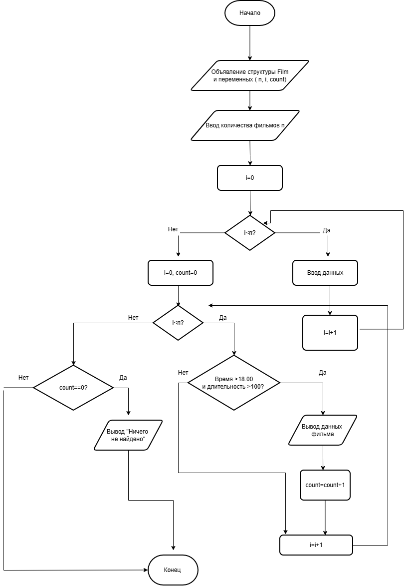

# Домашнее задание №18
## 1. Алгоритм и блок-схема
### Алгоритм
1. **Начало**
1. Начало программы.
2. Объявление структуры Film (поля: название, дата, час, минуты, длительность, жанр, бюджет).
3. Объявление переменных: массив фильмов f[10], счетчик количества n, счетчик цикла i, счетчик найденных count.
4. Ввод количества фильмов n (от 5 до 10).
5. Цикл ввода данных (пока i < n):
 • Вывести номер фильма.
 • Считать название, дату, время (часы и минуты), длительность, жанр, бюджет.
 • Увеличить i на 1.
6. Инициализация поиска: обнулить счетчик i = 0 и счетчик найденных count = 0.
7. Вывести заголовок "--- Подходящие фильмы ---".
8. Цикл поиска (пока i < n):
 • Проверка условия: (час > 18 ИЛИ (час == 18 И минуты > 0)) И (длительность > 100).
 • Если условие истинно (Да):
  • Вывести данные фильма (название, дату, время, длительность, жанр, бюджет).
  • Увеличить count на 1.
 • Увеличить i на 1 (перейти к следующему фильму).
9. Проверка результата: count == 0?
 • Если Да: Вывести "Ничего не найдено.".
 • Если Нет: ничего не выводить (программа уже вывела фильмы в шаге 8).
10. **Конец**
   ### Блок-схема
   
## 2.Вывод программы
Сколько фильмов ввести? (5-10): 6

Фильм 1:
Название (одним словом): Интерстеллар
Дата: 12.11.2026
Время (часы и минуты через пробел): 19 30
Длительность (в минутах): 169
Жанр: Фантастика
Бюджет: 165000000

Фильм 2:
Название (одним словом): Барби
Дата: 12.11.2026
Время (часы и минуты через пробел): 15 00
Длительность (в минутах): 114
Жанр: Комедия
Бюджет: 145000000

Фильм 3:
Название (одним словом): Джокер
Дата: 13.11.2026
Время (часы и минуты через пробел): 20 00
Длительность (в минутах): 90
Жанр: Драма
Бюджет: 55000000

Фильм 4:
Название (одним словом): Оппенгеймер
Дата: 14.11.2026
Время (часы и минуты через пробел): 18 00
Длительность (в минутах): 180
Жанр: Биография
Бюджет: 100000000

Фильм 5:
Название (одним словом): Дюна
Дата: 15.11.2026
Время (часы и минуты через пробел): 21 15
Длительность (в минутах): 155
Жанр: Фантастика
Бюджет: 165000000

Фильм 6:
Название (одним словом): Драйв
Дата: 16.11.2026
Время (часы и минуты через пробел): 19 00
Длительность (в минутах): 100
Жанр: Боевик
Бюджет: 15000000

--- Подходящие фильмы ---
Интерстеллар | 12.11.2026 | 19:30 | 169 мин | Фантастика | 165000000.00
Дюна | 15.11.2026 | 21:15 | 155 мин | Фантастика | 165000000.00
## 3. Информация о разработчике
Панкова Дарья, бИЦТ-262
